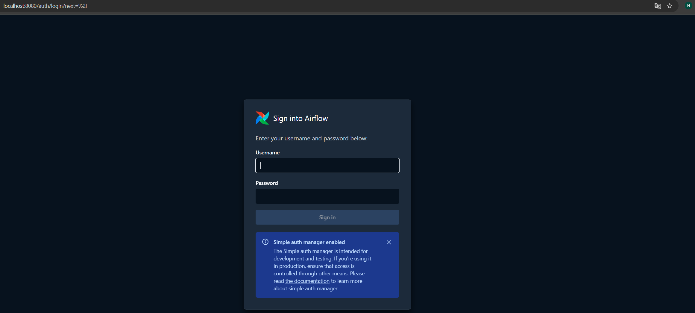
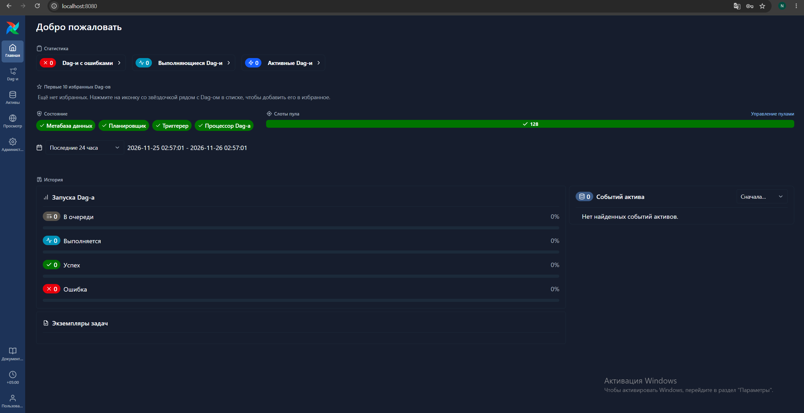
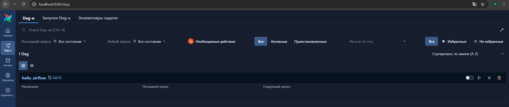
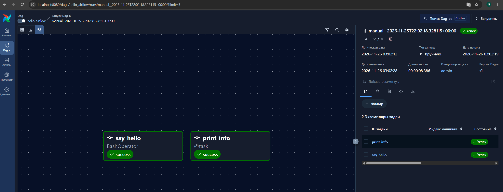
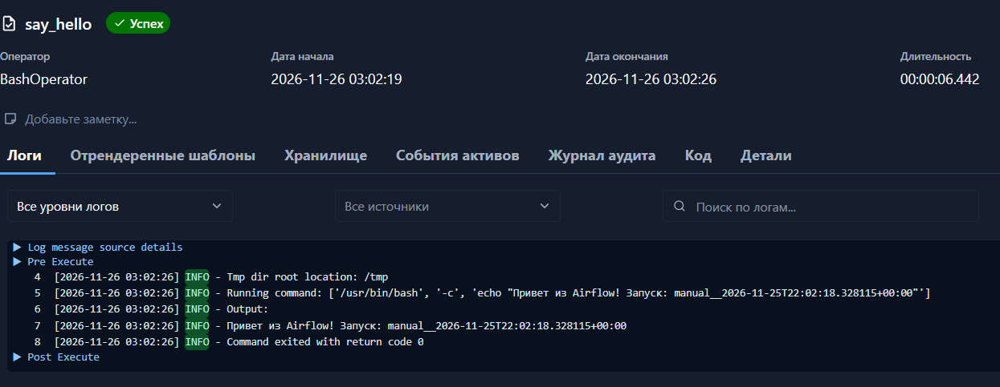
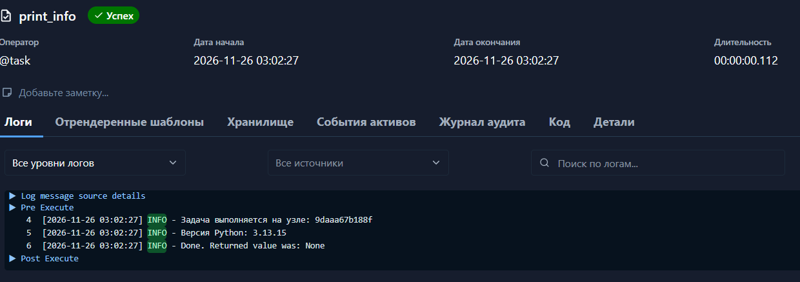
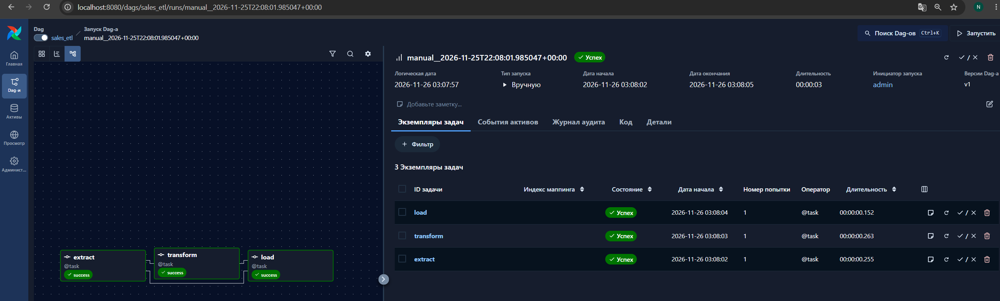
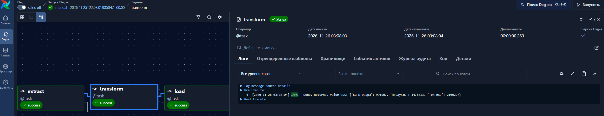
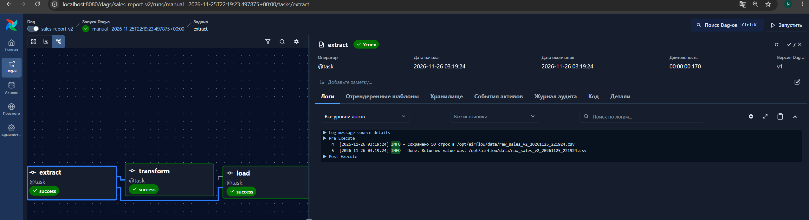
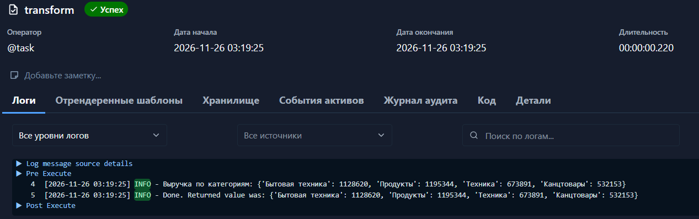

<div align="center">

# ⚙️ Лабораторная работа 10

### Введение в Apache Airflow: первый конвейер данных


**Студент:** Маликов Нурдаулет  
**Тема:** Apache Airflow
**Специальность:** Прикладная статистика и Data Science  
**Проверил(а):** Тихонова О. А.  
**Репозиторий:** [MalikovNurdaulet/VOT-Lab10](https://github.com/MalikovNurdaulet/VOT-Lab10)

</div>

# 🐧 Linux server
## Система
- https://hip.hosting/
- Ubuntu 24.04 LTS
- В качестве виртуальной машины использован облачный VPS-сервер с операционной системой Ubuntu 24.04 LTS. Доступ к серверу осуществляется удалённо по протоколу SSH
- 2 vCPU · 4 GB RAM · 40 GB SSD · 200 Mbps


## 1. Цель работы
Познакомиться с платформой оркестрации Apache Airflow: развернуть её в Docker, научиться 
описывать конвейер обработки данных в виде DAG, запускать его вручную и по расписанию, 
читать журналы задач и находить ошибки.

## 2. Задачи работы
- запустить Apache Airflow 3 в контейнере с помощью Docker Compose и войти в вебинтерфейс; 
- изучить основные элементы интерфейса: список DAG, граф, сетка запусков, журналы; 
- написать первый DAG из двух задач и запустить его вручную; 
- построить конвейер ETL из трёх задач (extract → transform → load) с передачей данных через XCom; 
- настроить расписание и автоматические повторы задачи при сбое; 
- выполнить индивидуальное задание и ответить на контрольные вопросы.

## 3. Программное обеспечение 
- Docker Desktop (Windows 10/11 с WSL 2) или Docker Engine с плагином Docker Compose 
- (Linux) — из предыдущих лабораторных работ; 
- образ apache/airflow:3.3.2 с Docker Hub (около 1,5 ГБ для загрузки); 
- не менее 4 ГБ свободной оперативной памяти для Docker; 
- VS Code (или любой редактор кода) для работы с файлами DAG на Python; 
- браузер для веб-интерфейса Airflow (http://localhost:8080). 


## 4. Краткие теоретические сведения 
Apache Airflow — открытая платформа для создания, планирования и мониторинга рабочих процессов (workflows).  
Конвейер описывают кодом на Python, а Airflow сам запускает задачи в нужном порядке, по расписанию, повторяет их при сбое и сохраняет журналы.  
Типичные задачи:  
    ежедневная выгрузка данных, очистка и загрузка в базу (ETL), переобучение модели на свежих данных  
    Airflow не обрабатывает данные сам: он управляет тем, когда и в каком порядке выполняются задачи  
    Саму работу делают скрипты, SQL-запросы или внешние системы  

### 4.1. Краткие теоретические сведения 
- DAG (Directed Acyclic Graph, направленный ациклический граф) — описание конвейера: 
набор задач и связей между ними. «Ациклический» означает, что циклов нет: задача не 
может зависеть сама от себя через другие задачи. DAG хранится в файле .py в папке dags. 
- Задача (task) — один шаг конвейера: функция Python, команда bash, SQL-запрос. 
- Оператор (operator) — шаблон задачи определённого типа: BashOperator выполняет 
команду оболочки, декоратор @task превращает обычную функцию Python в задачу. 
- Запуск DAG (DAG run) — одно выполнение всего конвейера: по расписанию или вручную. 
Внутри него каждая задача получает свой экземпляр задачи (task instance) со статусом и 
журналом. 
- Зависимости задают порядок: запись a >> b означает «сначала a, потом b». 
- Расписание (schedule) — как часто запускать DAG: пресет (@hourly, @daily, @weekly), cron
выражение ("0 6 * * *" — каждый день в 06:00 UTC) или None — только вручную. 
- XCom (cross-communication) — механизм передачи небольших значений между задачами: 
чисел, строк, путей к файлам. Большие таблицы через XCom не передают: их сохраняют в 
файл или БД, а в XCom кладут путь.

### 4.3. Статусы задачи 
| Статус | Цвет в интерфейсе | Значение |
|---|---|---|
| queued | серый  | задача в очереди на выполнение  |
| running  | салатовый | выполняется  |
| success  | зелёный  | завершена успешно  |
| failed  | красный  | завершена с ошибкой, попытки исчерпаны  |
| up_for_retry  | жёлтый  | упала, будет повторена  |
| upstream_failed  | оранжевый  | не запускалась, потому что упала предыдущая задача   |

## 5. Ход работы 
### Шаг 1. Подготовка проекта 
```console
root@hiplet-123755:~# ls
    errors.log  lab7  lab8  lab9  linux_lab  listing.txt  project  tasks.txt  tgbot
root@hiplet-123755:~# mkdir lab10
root@hiplet-123755:~# ls
    errors.log  lab10  lab7  lab8  lab9  linux_lab  listing.txt  project  tasks.txt  tgbot
root@hiplet-123755:~/lab10# mkdir -p airflow-lab/dags airflow-lab/data
root@hiplet-123755:~/lab10# cd airflow-lab
root@hiplet-123755:~/lab10/airflow-lab# echo "AIRFLOW_UID=50000" > .env
root@hiplet-123755:~/lab10/airflow-lab# ls -la
    total 20
    drwxr-xr-x 4 root root 4096 Nov 25 21:14 .
    drwxr-xr-x 3 root root 4096 Nov 25 21:14 ..
    -rw-r--r-- 1 root root   18 Nov 25 21:14 .env
    drwxr-xr-x 2 root root 4096 Nov 25 21:14 dags
    drwxr-xr-x 2 root root 4096 Nov 25 21:14 data
```

### Шаг 2. Запуск Airflow в Docker Compose 
 ```console
root@hiplet-123755:~/lab10/airflow-lab# nano docker-compose.yml
root@hiplet-123755:~/lab10/airflow-lab# cat docker-compose.yml
services:
  airflow:
    image: apache/airflow:3.3.2
    container_name: airflow
    command: standalone
    user: "${AIRFLOW_UID:-50000}:0"
    ports:
      - "127.0.0.1:8080:8080"
    environment:
      AIRFLOW__CORE__LOAD_EXAMPLES: "false"
      AIRFLOW__DAG_PROCESSOR__REFRESH_INTERVAL: "30"
    volumes:
      - ./dags:/opt/airflow/dags
      - ./data:/opt/airflow/data
```

- **command: standalone** — запускает все службы Airflow в одном контейнере и создаёт пользователя admin; 
- **ports** — веб-интерфейс будет доступен на http://localhost:8080; 
- **AIRFLOW__CORE__LOAD_EXAMPLES** — отключает десятки встроенных примеров, чтобы в списке были только ваши DAG; 
- **AIRFLOW__DAG_PROCESSOR__REFRESH_INTERVAL** — проверять папку dags на новые файлы каждые 30 секунд (по умолчанию — раз в 5 минут); 
- **volumes** — папки с вашего компьютера становятся доступны внутри контейнера. Файл, сохранённый в VS Code, сразу виден Airflow.

### Запустите контейнер и посмотрите журнал: 
```console
root@hiplet-123755:~/lab10/airflow-lab# docker compose config
    name: airflow-lab
    services:
    airflow:
        container_name: airflow
        command:
        - standalone
        environment:
        AIRFLOW__CORE__LOAD_EXAMPLES: "false"
        AIRFLOW__DAG_PROCESSOR__REFRESH_INTERVAL: "30"
        image: apache/airflow:3.3.2
        networks:
        default: null
        user: '50000:0'
        volumes:
        - type: bind
            source: /root/lab10/airflow-lab/dags
            target: /opt/airflow/dags
            bind: {}
        - type: bind
            source: /root/lab10/airflow-lab/data
            target: /opt/airflow/data
            bind: {}
        ports:
        - mode: ingress
            host_ip: 127.0.0.1
            target: 8080
            published: "8080"
            protocol: tcp
    networks:
    default:
        name: airflow-lab_default
root@hiplet-123755:~/lab10/airflow-lab# docker compose up -d
    [+] up 25/25
    ✔ Image apache/airflow:3.3.2  Pulled                                                                              37.5s
    ✔ Network airflow-lab_default Created                                                                              0.0s
    ✔ Container airflow           Started                                                                              0.4s
root@hiplet-123755:~/lab10/airflow-lab# docker compose logs -f airflow
    airflow  | standalone | Starting Airflow Standalone
    ...
    airflow  | standalone | Database ready
    ...
    airflow  | triggerer  | ____________       _____________
    airflow  | triggerer  | ____    |__( )_________  __/__  /________      __
    airflow  | triggerer  | ____  /| |_  /__  ___/_  /_ __  /_  __ \_ | /| / /
    airflow  | triggerer  | ___  ___ |  / _  /   _  __/ _  / / /_/ /_ |/ |/ /
    airflow  | triggerer  | _/_/  |_/_/  /_/    /_/    /_/  \____/____/|__/
    ...
    airflow  | dag-processor | DAG File Processing Stats
    ^C
root@hiplet-123755:~/lab10/airflow-lab# docker compose ps -a
    NAME      IMAGE                  COMMAND                  SERVICE   CREATED          STATUS          PORTS
    airflow   apache/airflow:3.3.2   "/usr/bin/dumb-init …"   airflow   23 minutes ago   Up 23 minutes   127.0.0.1:8080->8080/tcp
```

### Пароль администратора 
 ```console
root@hiplet-123755:~/lab10/airflow-lab# docker exec airflow cat /opt/airflow/simple_auth_manager_passwords.json.generated
    {"admin": "CHqpt2nEfpUB8kRn"}
```
### Шаг 3. Знакомство с веб-интерфейсом  
 ```console
PS C:\Users\User> ssh -N -L 8080:127.0.0.1:8080 root@185.106.97.156
root@185.106.97.156's password:
```




### Шаг 4. Первый DAG
 ```console
root@hiplet-123755:~/lab10/airflow-lab# docker exec airflow airflow dags list
    dag_id        | fileloc                            | owners  | is_paused | bundle_name | bundle_version
    ==============+====================================+=========+===========+=============+===============
    hello_airflow | /opt/airflow/dags/hello_airflow.py | airflow | True      | dags-folder | None
```










### Шаг 5. Конвейер ETL
 ```console
root@hiplet-123755:~/lab10/airflow-lab# docker exec airflow airflow dags list
    dag_id        | fileloc                            | owners  | is_paused | bundle_name | bundle_version
    ==============+====================================+=========+===========+=============+===============
    hello_airflow | /opt/airflow/dags/hello_airflow.py | airflow | False     | dags-folder | None
    sales_etl     | /opt/airflow/dags/sales_etl.py     | airflow | True      | dags-folder | None
```

### Шаг 5.2.



### Шаг 5.3.



### Шаг 5.4.
 ```console
root@hiplet-123755:~/lab10/airflow-lab# ls -lh data/
    total 8.0K
    -rw-rw-r-- 1 50000 root 1.9K Nov 25 22:08 raw_sales_20261125_220802.csv
    -rw-rw-r-- 1 50000 root   96 Nov 25 22:08 report_20261125_220802.json
root@hiplet-123755:~/lab10/airflow-lab# head -n 10 data/raw_sales_*.csv
    product,category,qty,price
    Тетрадь,Канцтовары,4,42107
    Чай,Продукты,3,26600
    Ноутбук,Техника,4,10452
    Мышь,Техника,5,10216
    Ноутбук,Техника,4,44620
    Ноутбук,Техника,4,18969
    Ноутбук,Техника,1,11517
    Тетрадь,Канцтовары,2,19333
    Кофе,Продукты,4,41000
root@hiplet-123755:~/lab10/airflow-lab# cat data/report_*.json
    {
    "Канцтовары": 991567,
    "Продукты": 1476313,
    "Техника": 2106227
    }
 
```


## 6. Задание 
### 6.1. Расписание — каждые 6 часов (cron-выражение "0 */6 * * *"), catchup=False, 3 повтора с паузой 10 секунд.  
### 6.2. Задача extract — такая же, как в sales_etl, но добавьте в словарь PRODUCTS ещё два товара новой категории.
 ```console
root@hiplet-123755:~/lab10/airflow-lab# nano dags/sales_report_v2.py
root@hiplet-123755:~/lab10/airflow-lab# docker exec airflow airflow dags list
    dag_id          | fileloc                              | owners  | is_paused | bundle_name | bundle_version
    ================+======================================+=========+===========+=============+===============
    hello_airflow   | /opt/airflow/dags/hello_airflow.py   | airflow | False     | dags-folder | None
    sales_etl       | /opt/airflow/dags/sales_etl.py       | airflow | False     | dags-folder | None
    sales_report_v2 | /opt/airflow/dags/sales_report_v2.py | airflow | True      | dags-folder | None
```



 ```console
root@hiplet-123755:~/lab10/airflow-lab# ls -lh data/
    total 16K
    -rw-rw-r-- 1 50000 root 1.9K Nov 25 22:08 raw_sales_20261125_220802.csv
    -rw-rw-r-- 1 50000 root 2.2K Nov 25 22:19 raw_sales_v2_20261125_221924.csv
    -rw-rw-r-- 1 50000 root   96 Nov 25 22:08 report_20261125_220802.json
    -rw-rw-r-- 1 50000 root  139 Nov 25 22:19 report_v2_20261125_221924.json
root@hiplet-123755:~/lab10/airflow-lab# head -n 10 data/raw_sales_v2_*.csv
    product,category,qty,price
    Микроволновка,Бытовая техника,4,36588
    Чай,Продукты,4,39185
    Микроволновка,Бытовая техника,1,38197
    Микроволновка,Бытовая техника,4,13486
    Чай,Продукты,1,43298
    Мышь,Техника,1,2121
    Тетрадь,Канцтовары,5,9494
    Чайник,Бытовая техника,3,45527
    Тетрадь,Канцтовары,2,1607
root@hiplet-123755:~/lab10/airflow-lab# cat data/report_v2_*.json
    {
    "Бытовая техника": 1128620,
    "Продукты": 1195344,
    "Техника": 673891,
    "Канцтовары": 532153
    }
```


## 7. Контрольные вопросы
### ❓1. Для чего предназначен Apache Airflow? Обрабатывает ли он данные сам? 
- **Apache Airflow** предназначен для оркестрации, планирования и мониторинга рабочих процессов
- не обрабатывает данные самостоятельно, а управляет порядком и временем выполнения задач
- Обработку выполняют Python-скрипты, SQL-запросы или внешние системы.
### ❓2. Что такое DAG? Почему граф должен быть ациклическим? 
- **DAG (Directed Acyclic Graph)** направленный ациклический граф, описывающий задачи и зависимости между ними.
### ❓3. Чем задача отличается от экземпляра задачи? А DAG — от запуска DAG? 
- Task описание отдельной задачи.
- Task Instance конкретное выполнение задачи в рамках запуска DAG.
- DAG описание всего рабочего процесса.
- DAG Run конкретный запуск рабочего процесса вручную или по расписанию.
### ❓4. Какие службы входят в Airflow 3 и что делает каждая? Чем режим standalone отличается от промышленной установки? 

### ❓5. Как задать порядок выполнения задач? Приведите два способа из этой работы. 
- say_hello >> print_info()
- raw = extract()   load(transform(raw), raw)
### ❓6. Что такое XCom? Почему через него передают путь к файлу, а не сами данные? 
- **XCom (Cross-Communication)** механизм обмена небольшими объёмами данных между задачами Airflow.
### ❓7. Что означают параметры schedule="@daily" и catchup=False? Как записать расписание «каждый понедельник в 09:00» в виде cron? 
- **schedule="@daily"** автоматический запуск DAG один раз в сутки.
- **catchup=False** отключение автоматического выполнения пропущенных исторических интервалов.
- schedule="0 9 * * 1"  
### ❓8. Зачем в docker-compose.yml подключены тома ./dags и ./data? Что потеряется после docker compose down?
- ./dags подключается для хранения Python-файлов с описанием DAG
- ./data для хранения исходных данных и результатов обработки.
- выполнения docker compose down контейнер и сеть будут удалены, но файлы в папках ./dags и ./data сохранятся